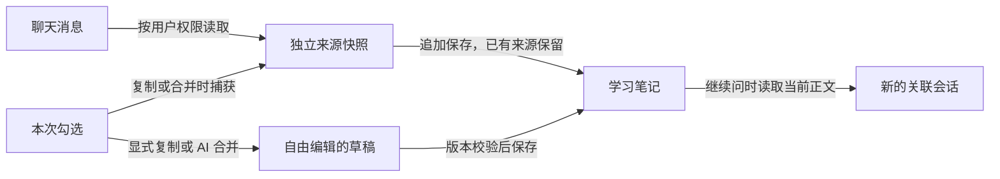

# MemoryAI 对象关系与操作规则

2026-11-13。依据当前代码重新梳理；用户已选择“原始问答独立保留、正文自由编辑、不永久追踪复制片段”的方案。本文件是当前笔记行为的依据，替代早期修复记录中关于字符区间、原文自动判重和自建撤销历史的约定。

## 项目中的事实与派生结果

| 对象 | 权威数据 | 操作与关系 |
| --- | --- | --- |
| 用户 | MySQL `user` | 用户 ID 决定数据归属；前端角色只控制展示，后端校验权限 |
| 登录会话 | Redis Spring Session | 关联用户身份。暂停 RAG 不会取消登录对 Redis 的依赖 |
| 聊天会话与消息 | `chat_session`、有序 `chat_message` | 消息 ID 标识一条历史事实；界面等待动画和 SSE 完成/停止/失败状态分开 |
| 学习笔记 | `learning_note` 的正文、来源快照、版本 | 用户可编辑的学习产物；不是聊天记录的镜像，也不是原文片段的索引 |
| 题目与答题 | `quiz_question`、`quiz_record` | 每次提交形成答题事实；错题本和数值掌握度从这些事实更新 |
| 错题本 | 最新错误答题且未手动移出的投影 | 重做正确后退出；移出错题本不删除答题事实，不改变既有成绩 |
| 刷题掌握度 | `user_mastery` | 由刷题更新，读取时计算衰减；不等同于笔记的手动学习状态 |
| 面试 | `interview_session`、`interview_answer`、报告 | 保留题目、简历和能力快照；草稿、提交推进、结束和评估分别执行，缓存可由持久记录恢复 |
| 面试画像 | `user_skill_profile` | 报告保存后异步生成；生成失败不撤销面试报告，不自动改写笔记或刷题数值 |
| 简历 | 用户所属 `resume` | 上传、解析、READY/失败；面试保留创建时的简历文本快照 |
| 可选知识库 | MySQL 知识库/文档/切片与 ES 索引 | RAG 开关控制检索相关设施；核心聊天、笔记、简历和面试继续运行 |

当前实现已有适当的业务边界，不需要换框架、拆微服务或迁移全部包。`rag` Maven 模块也承载核心聊天和笔记，模块名不表示它整体受 RAG 开关控制。

代码依据：`ChatSessionService`、`StreamingChatService`、`LearningNoteService`、`WrongQuestionService`、`UserMasteryService`、`InterviewPersistenceService`、`InterviewSessionService`、`AnswerEvaluationService`、`ProfileGenerationService` 与 `ConditionalOnRagEnabled`。本轮全项目审视用于厘清对象和兼容性边界，不等同于对所有业务代码重新完成安全审计。

## 笔记内容与编辑状态

| 对象 | 保存位置 | 含义 |
| --- | --- | --- |
| 正文草稿 | 编辑器本地；保存后成为笔记正文 | 标题、困惑、Markdown 正文、学习状态。任意手写、删除、撤销、AI 改写都不改变来源身份 |
| 原始问答 | 已保存快照＋本次操作已捕获的消息 | 保留消息 ID、角色、原文和会话 ID。服务器从用户有权访问的消息生成快照；已有快照按 ID 保留原值 |
| 当前勾选 | 编辑器临时状态 | 决定下一次复制、合并或直接保存要附带哪些问答。勾选本身不重写正文，不删除已捕获来源 |
| 已保存版本 | MySQL 中同一条笔记及 `version` | 正文和新增来源一起保存；请求使用打开时的版本，旧版本不能覆盖新版本 |

`sourceSnapshot` 是来源依据，`sourceMessageIds` 是其 ID 列表，`sourceSessionId` 记录初始来源会话。快照中的每条消息有自己的 `sessionId`，可跨多次继续问积累。`chat_session.note_id` 表示继续问的背景及自动整理的目标笔记，不表示正文里仍含原文。自动整理的逐轮处理状态另存于已有消息 metadata，不从来源快照或正文相似度推断是否处理过；详细接口和行为见 [学习笔记知识树](learning-note-tree-backend.md)。

## 操作规则

| 操作 | 正文 | 原始问答 | 当前选择与失败行为 |
| --- | --- | --- | --- |
| 聊天自动整理 | 回答完整落库后，生成问题标题并归入目录，不生成摘要；重复澄清可关联旧节点 | 保存本轮独立原文快照，节点记录消息编号 | 默认开启，可关闭；失败保留问答并提供重试，版本冲突不覆盖手动修改 |
| 点击问题节点 | 不改正文，主区回看对应原问答 | 从独立快照读取，无法对应的旧节点明确说明 | 下方按需推荐尚未聊过的问题；点击推荐直接发送，带上该节点原问答背景 |
| 从聊天新建 | 默认复制初始所选问答；超过正文上限时留空并提示 | 初始复制成功即捕获来源 | 原文单独可查看；先填写正文或减少选择后操作 |
| 打开已有笔记 | 使用保存的正文 | 使用保存的快照 | 默认选择当前问答，尚不改写笔记 |
| 勾选、取消勾选 | 不变 | 不删除已捕获来源 | 仅改变下次操作对象；选择最多 40 条 |
| 复制所选原文到正文 | 在末尾明确插入一份文字 | 捕获本次问答，按 ID 去重 | 再次复制就是再次插入；不声称自动判断正文是否已包含原文 |
| 将所选原文填入正文 | 确认后替换正文 | 捕获本次来源，已有来源仍保留 | 取消确认、超限时保持原草稿 |
| 手动修改、撤销、重做 | 浏览器原生文本编辑 | 不变 | 不维护字符位置或第二套撤销历史 |
| 整理正文 `BODY` | AI 只整理当前标题、困惑和正文 | 不捕获当前未使用的勾选来源 | 不发送消息 ID；取消全部勾选仍可整理 |
| 结合所选问答整理 `MERGE` | AI 同时接收当前草稿和明确所选问答 | 成功后捕获本次来源 | 模型失败、输入超限时保留原草稿与原捕获集合 |
| 保存 | 保存当前编辑字段 | 保存“已有＋已成功复制/合并＋当前勾选”的并集 | 点击保存即把所选来源纳入草稿；失败后取消勾选不丢此次保存意图，关闭会提示未保存 |
| 详情页编辑保存 | 更新编辑字段 | 不增删来源 | 不读取已被删除的来源会话 |
| 发生版本冲突 | 不覆盖服务器，保留本地草稿 | 不自动合并两版来源 | 可另开页面查看；明确载入最新后整体替换正文、来源和版本 |
| 继续问 | 创建会话时不改正文；之后依自动整理开关更新问题目录 | 有效整理时追加本轮来源 | 创建关联会话；推荐或明确从节点继续问时使用原问答背景，单纯浏览节点不改变讨论起点 |
| 删除来源会话 | 不变 | 快照仍可查看 | 来源会话链接可能失效，快照不依赖该链接 |
| 删除笔记 | 删除笔记 | 随笔记删除 | 保留聊天并解除笔记关联 |

直接保存仍可关联当前所选来源，但不会自动把它们写入正文。当前选择只有在执行保存/复制/合并时才成为持久化意图；单纯勾选不是正文修改。

## 输入边界与兼容性

- 正文最多 40000 字，标题 120 字，困惑 4000 字；这里沿用 Java/JavaScript 的字符串长度约定。
- `BODY` 可处理合法的 40000 字正文，不重复附加来源，也不通过文本相似度判断消息身份。
- `MERGE` 最多选 40 条，正文与所选问答原文合计最多 40000 字。超限时明确提示：已复制原文可改用“整理正文”，否则减少选择或精简正文；不静默截断，也不自动增加模型调用次数。
- 保存来源是多次操作的聚合，不复用单次 40 条的限制；累计来源原文仍限 120000 字。超限不保存半份内容。
- 创建请求编号维持幂等，已有 hash 算法不变；版本更新、用户隔离、消息可见性校验继续生效。
- 旧 `source_ranges` 数据库列保留，业务代码不读取、维护或依赖它。无需回填、猜测或改写历史笔记；旧版迁移文件仅作部署历史保留。
- 旧 API 请求中的位置字段不再影响新逻辑。缺少 AI `mode` 的旧请求默认 `MERGE`；部署后应刷新前端，使用明确的两个按钮。
- 前端只在 API 边界解析来源 JSON，组件收到类型明确的 `sources` 数组。

## 验收依据

验收按业务规则组织，替换以字符位置算法为中心的旧断言，保留其保护的用户数据场景：

1. 新建、编辑、搜索、保存、重开、继续问及更新来源正常；模型失败、保存失败和冲突可恢复。
2. 取消勾选不改正文；复制后取消勾选再保存重开，原始问答仍在，长正文用 `BODY` 整理成功。
3. 相同短答案、前缀答案和分批乱序复制，都按明确选择完整复制；来源按 ID 去重，正文没有自动判重副作用。
4. 长文本完整撤销、完整重做、全文删除恢复不改变来源；不依赖 100 次等自建历史容量。
5. `BODY` 不查询来源；`MERGE` 只接收所选来源，真实超限和模型失败不改变草稿。成功后保存时保留成功使用的来源。
6. 聚合超过 40 条来源可以保存；来源字数上限、权限、幂等和乐观锁仍有效。
7. 加载冲突最新版丢弃旧草稿及其未保存来源；删除来源会话后详情编辑仍可保存。
8. 全量已有业务测试核对聊天、刷题、错题本、面试、简历、账号隔离和 RAG 开关；另做真实浏览器与本地服务验证，不把 mock 模型当成真实模型。

实施与实测结果见[本轮验证记录](note-model-convergence-verification.md)；仅测试通过不表示未覆盖的组合已经被证明正确。
